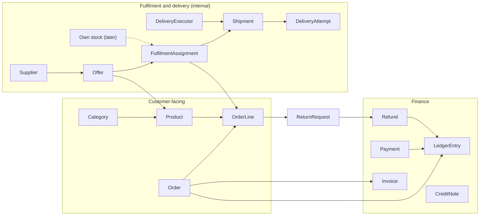
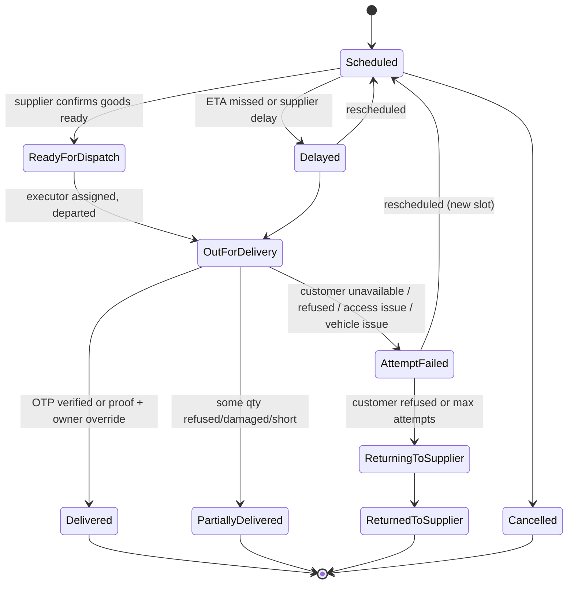

# Platform Design v1 — MVP Spec

**Status:** v1.2 draft for review (S1 Design) · 2026-10-21 · Arvind
**Supersedes:** v1.1 (commit `c096573`) and v1.0 (commit `49b8aa1`), same file. Change summary in §0.

---

## 0. Change log

### Changes in v1.2 (second independent review)

| Finding | Change | Where |
| --- | --- | --- |
| A. Ledger sign convention and reconciliation unclear | Single accounting equation per account; refund request ≠ money movement; five worked examples (prepaid, COD, partial delivery, return, refused COD) | §10 |
| B. Supplier failure after a shipment exists | Shipment lines reference an assignment; supplier failure cancels and supersedes the shipment and assignment together; new assignment + new shipment; source of a shipment never edited; assignment gains Completed state | §5, §9.3, §9.4 |
| C. Immutable order vs adjustments | Three record layers (intent, operations, finance); ledger customer account is the authoritative balance; invoice − credit notes must equal net charges for invoiced lines | §2 I-3, §10.1 |
| D. Invoice timing undefined | Invoice policy is a required live-mode setting with three defined options and their credit-note consequences; live invoicing blocked until set and CA-approved (D13) | §4.1, §10.4 |
| E. Load test underspecified | Mixed workload profile, saturation and queue-lag tests, pass criteria | §3.7 |
| F. Supplier privacy vs delivery contact | I-1 now distinguishes supplier identity/commercial data from the delivery contact needed to receive goods; supplier paperwork rule moved into supplier terms (D17) | §2, §8, §14 |
| G. Return window and closure | Window starts per line at delivery; requests before expiry keep the order open; refund request is not a ledger movement; Failed refunds block closure; Owner-only reopen | §9.1, §9.5 |
| H. Live gate was a flag | Go-live checklist with evidence, verifier and automatic revocation; supplier verification before live assignment | §4.1, §5 |

### Changes in v1.1

| Area | Change | Driven by |
| --- | --- | --- |
| Scope | New §1 splits work into: architecture from day one · MVP features · deferred · open decisions | Owner requirement 5 |
| Invariants | I-1…I-5 tightened with enforcement mechanism; I-6…I-9 added (versioned config, live-mode gate, ledger, verified payments) | Review findings, owner req. 1–3 |
| Architecture | Capacity assumptions for 100,000 requests/day; app + worker processes; Postgres-backed job queue; scaling thresholds; observability, backup, security | Owner req. 4 |
| Configuration | New §4: business profile and GSTIN in admin settings, test/live gate, typed versioned rule sets for prices, fees, delivery, minimums, zones | Owner req. 1–2 |
| Domain model | Added BusinessProfile, RuleSet/Rule, Shipment, DeliveryAttempt, DeliveryExecutor, ReturnRequest, Refund, CreditNote, Invoice, LedgerEntry, ReasonCode | Owner req. 1–3 |
| Pricing | Distinct financial components: goods value, delivery charge, platform fees, tax, supplier cost, delivery cost, gateway fee | Owner req. 2 |
| Lifecycle | Explicit state machines for order, payment, assignment, shipment, return, refund; reason codes; recovery workflows | Owner req. 3, review |
| Delivery | Shipments per fulfilment source; delivery executor (supplier, own, third party); delivery OTP or proof against false confirmation; tracking designed, not built | Owner req. 3 |
| Finance | Append-only ledger per order; reconciliation of gateway, COD, refunds, supplier payables | Owner req. 3, review |
| Admin | Settings, rule editor, shipments, returns/refunds, reconciliation screens; bulk CSV and analytics deferred | Owner req. 5, review |
| Build | 10 → 12 sessions | All of the above |

v1.0 decisions kept unchanged: Product / Offer / FulfilmentAssignment model; modular monolith; one Postgres database; manual supplier assignment in MVP.

---

## 1. Scope

The MVP is a single-seller storefront for Gurgaon. Customers order construction materials in small quantities; the owner sets every price and fee through configuration; each order line is assigned by hand to a supplier; delivery is tracked per shipment with explicit states. The architecture is built from day one to accept more suppliers, own inventory, delivery partners and cities without a rebuild, but those capabilities are not implemented yet.

### 1.1 Architecture must support from day one

These are structural; retrofitting them later is expensive.

- Stateless application instances behind a load balancer (horizontal scaling) and a separate worker process for background jobs (§3)
- Business rules as **typed, versioned configuration data**, never hardcoded constants (§4)
- Test/live mode gate on tax and payment operations (I-7)
- Product / Offer / FulfilmentAssignment separation, with `source_type` extensible to own stock (§5)
- Shipment as the unit of delivery, with an executor type extensible to supplier, own fleet and third-party partners (§9)
- Explicit state machines with a single transition function per entity; every transition logged with actor, time, reason (I-4)
- Append-only financial ledger per order (I-8)
- Idempotent, signature-verified payment webhooks (I-9)
- Structured logging, error monitoring, metrics, daily backups with tested restore (§3.6)
- City and zone as data, so a second city is configuration plus suppliers (§4)

### 1.2 Implemented in the MVP

- Storefront: browse, product page, quantity rules, cart, pincode gate (§6, §8)
- Checkout: phone OTP, address with optional map pin, slot, UPI via gateway, COD subject to D5 (§8)
- Admin settings: business profile, GSTIN, invoice series, test/live mode (§4.1)
- Admin rule editor: prices, supplier costs, delivery charges, platform fees, minimum orders, free-delivery thresholds, zones, slots (§4.2)
- Manual supplier assignment with confirmation deadline and reassignment (§9)
- Shipments with manually entered delivery person, ETA and delivery OTP or proof of delivery (§9)
- Failed attempts, rescheduling, partial/damaged/incorrect deliveries, returns, pickups, refunds, credit notes — all **manually operated** through admin (§9)
- Ledger and reconciliation views: gateway payments, COD collection, refunds, supplier payables (§10)
- SMS/WhatsApp notifications through the background queue (§11)
- GST tax invoice and credit note PDFs, blocked in test mode (§4.1)

### 1.3 Intentionally deferred

| Deferred | Why now is too early | Design hook already in place |
| --- | --- | --- |
| Live GPS tracking for customers | Needs a delivery-person app and location consent | Tracking window and data shape designed (§9.6) |
| Delivery-person mobile app | Volume does not justify it | `DeliveryExecutor` + shipment states |
| Third-party delivery API integrations | No partner chosen | `executor_type = THIRD_PARTY`, external reference field |
| Supplier portal and supplier-managed listings | ≤5 suppliers at launch | Offer approval status (§13) |
| Own inventory | No stock held | `source_type = OWN_STOCK` (§13) |
| Marketplace seller model | Legal restructure, not a setting (§13) | Financial components kept distinct |
| Automated supplier routing | Manual is faster at this volume | Offers carry cost, lead time, zone |
| Splitting one order line across suppliers | Rare at small quantities; complicates reconciliation | Assignment carries `qty`; shipment lines carry quantities |
| Bulk CSV imports, analytics dashboards | 30–50 SKUs; single edits suffice | Admin APIs are per-record |
| Coupons, credit accounts, contractor pricing tiers | Not core to validating demand | Pricing rules accept new rule types |
| Redis, read replicas, separate services | Not needed at target load (§3.4) | Thresholds documented |
| Native mobile apps | Mobile web first | API-first route handlers |

### 1.4 Open decisions

Listed with owners and blockers in §14. Nothing in this document silently decides them; where a placeholder value is used it is marked **(placeholder, D-n)**.

---

## 2. Invariants (doctrine seeds)

Proposals to lift into `DOCTRINE.md` §2. Each names how it is enforced, so a violation is impossible or immediately visible rather than merely discouraged.

| | Invariant | Enforcement |
| --- | --- | --- |
| **I-1** | Supplier identity and commercial data (supplier name, GSTIN, address, offers, costs) never appear on any customer-facing surface. The only fulfilment data a customer sees is the **delivery contact** needed to receive the order: delivery person's name, phone, vehicle number and ETA — never the supplier's business name, even when the supplier's own driver delivers. | Storefront API returns customer DTOs that have no supplier fields; `catalog`/`checkout` cannot import `fulfilment` (lint rule); delivery contact comes from `DeliveryExecutor` only; notification templates have no supplier variables; contract test asserts storefront responses and notifications contain no supplier data. Physical paperwork from suppliers is governed by supplier terms (D17). |
| **I-2** | Goods price, supplier cost, platform fees, delivery charge and delivery cost are separate financial components with separate owners. | Separate columns and ledger entry types; operator role cannot read cost or margin fields (API-level authorisation, not just hidden UI). |
| **I-3** | A placed order's snapshot and any issued financial document are immutable. What happened afterwards is recorded in operational records; what it costs is recorded in financial records (§10.1). Corrections are always new records. | Money and snapshot columns are write-once (DB trigger rejects updates after placement); invoices and credit notes are insert-only; changes go through charge reversals, adjustments, credit notes or refunds. |
| **I-4** | Each order line has at most one active fulfilment assignment; a shipment line always references the assignment it fulfils, and a shipment's source never changes; every state change goes through the entity's transition function and is logged with actor, timestamp, reason code and note. | Partial unique index `(order_line_id) WHERE active`; FK from shipment line to assignment plus check that the assignment's source equals the shipment's source; quantity check: Σ quantity in non-cancelled shipment lines for an order line ≤ qty_ordered − qty_cancelled; transition functions run in one DB transaction with the event insert; direct status updates blocked by DB role permissions; event table is insert-only. |
| **I-5** | Money is integer paise; quantities are integers in the product's selling unit. | `bigint` paise columns; `integer` quantities with a check constraint `> 0`; no fractional quantities in v1. |
| **I-6** | Business rules are versioned configuration; an order records the exact rule versions and computed amounts it used. | Published rule versions are immutable; edits create a new version with `effective_from`; order stores rule version ids plus computed values. |
| **I-7** | No live transaction or tax invoice without a verified business configuration. | Placement in live mode and invoice issuance both check `BusinessProfile.status = VERIFIED` and `system_mode = LIVE`; test mode allows dummy data, uses gateway test keys only, and watermarks documents "TEST — not a tax invoice". |
| **I-8** | Every money movement is an append-only ledger entry; the ledger customer account is the authoritative customer balance; an order closes only when that balance is zero and no return or refund is unresolved. | `LedgerEntry` insert-only; one accounting equation (§10.2); close transition guard (§9.1). A refund request or approval creates no ledger entry — only a completed refund does. |
| **I-9** | Payment status changes only from a verified, idempotent gateway event or a recorded COD collection — never from a browser redirect. | Webhook signature verification; unique constraint on gateway event id; COD collection is an admin action with actor and executor recorded. |

**Candidate refusals:** no supplier-facing surfaces in v1; no automated price changes; no orders outside serviced zones; no live orders without verified business configuration; no live tax invoice without an approved invoice policy; no "delivered" without OTP or recorded proof.

---

## 3. Architecture and scalability

**Recommendation:** a modular monolith deployed as two process types (web and worker) from the same codebase, on one managed Postgres. This meets the 100,000 requests/day target with large headroom; microservices would add operational cost without solving a bottleneck at this scale. The thresholds that would justify splitting are in §3.4.

### 3.1 Capacity assumptions

The target is **100,000 application requests per day**. Requests are not orders or users. These figures are planning assumptions to be replaced by measured data; the system is **not claimed** to meet the target until the load test in S12 passes.

| Assumption | Value | Basis |
| --- | --- | --- |
| Active hours | 80% of traffic in 12 h (08:00–20:00) | Trade and homeowner buying hours |
| Average rate in active hours | ≈ 1.9 requests/s | 80,000 ÷ 43,200 s |
| Peak hour | 3× average ≈ 5.6 requests/s | Morning ordering peak |
| Spike (campaign, WhatsApp broadcast) | 10× average ≈ 19 requests/s | Marketing burst |
| **Design target** | **50 requests/s sustained for 15 min**, p95 < 500 ms for catalogue reads, p95 < 1.5 s for order placement | ≈ 2.5× the spike for headroom |
| Read/write mix | ~90% reads (catalogue, product, order status) / ~10% writes (cart, checkout, admin) | Typical commerce browse-to-buy ratio |
| Requests per session | ~25 | Pages + API calls |
| Sessions per day | ~4,000 | 100,000 ÷ 25 |
| Orders per day | ~80 (2% conversion) — MVP operations sized for 20–50 | Assumption; manual operations are the real ceiling |
| Concurrent users at peak | ~80–100 | 600 sessions in peak hour × ~8 min |
| Background jobs | ~1,000/day (≈ 8 notifications + webhooks + scheduled checks per order) | Order volume × job types |
| Database size, year 1 | < 5 GB excluding images | ~30,000 orders × lines, events, ledger |

At these numbers the bottleneck is human operations (assignment, delivery), not compute.

**Not the same thing:** 100,000 requests/day ≈ 4,000 sessions ≈ 80 orders. It is not 100,000 users/day or 100,000 orders/day; either of those would be a different design exercise. The architecture is called **proven** for this target only after the §3.7 load test passes.

### 3.2 Deployment topology

| Component | Choice | Scales by |
| --- | --- | --- |
| Web | Next.js (App Router) + TypeScript, stateless containers, minimum 2 instances for availability | Add instances (horizontal) |
| Worker | Same codebase, `worker` entrypoint; processes the job queue and schedules | Add instances; jobs are idempotent |
| Database | Managed Postgres (Mumbai region) with connection pooler | Vertical first; read replica at threshold |
| Job queue | Postgres-backed queue (e.g. pg-boss or Graphile Worker) | No extra infrastructure until threshold |
| Cache | CDN cache for catalogue pages and images (revalidated on price/product change); short in-process cache for config | Redis only at threshold |
| Files | Object storage + CDN for product images, POD photos, invoice PDFs | Managed |
| Payments | Razorpay (UPI, cards); webhook → queue | — |
| Messaging | Indian SMS/WhatsApp provider (e.g. MSG91, Gupshup) via worker | — |
| Hosting | A container platform with a Mumbai region that runs both web and worker processes **(vendor = D7)** | — |

Serverless-only hosting is not recommended because the worker needs a long-running process for queues and schedules.

### 3.3 Request and job handling

- **Synchronous path** stays short: catalogue reads, cart updates, order placement, admin actions.
- **Asynchronous path** (worker): notifications, webhook processing, supplier-confirmation timeouts, payment expiry, invoice PDF generation, daily reconciliation, backup verification.
- **Payment webhooks**: endpoint verifies signature, stores the raw event with unique gateway event id, enqueues, returns 200 in < 1 s. The worker applies the event through the payment transition function. Duplicates are no-ops (I-9).
- **Scheduled checks**: every minute the worker scans for expired pending payments, overdue supplier confirmations and overdue shipments, and moves them through their transition functions.
- **Idempotency**: order placement takes a client idempotency key; repeat submissions return the same order.

### 3.4 Scaling path and thresholds

| Signal (sustained over a week) | Action |
| --- | --- |
| Web CPU > 60% at peak, or p95 above target | Add web instances |
| DB CPU > 60% or connections near pool limit | Vertical DB upgrade; tune indexes; then add a read replica for catalogue/reporting reads |
| Job queue lag > 60 s at peak, or > ~50 jobs/s | Add worker instances; then move queue to Redis-backed queue |
| Cross-instance rate limiting or session needs exceed Postgres comfort | Add managed Redis |
| A module needs independent deployment, scaling or a separate team (e.g. high-volume tracking pings) | Extract that module behind its existing API as a service |
| Live GPS tracking launched | Tracking pings go to a separate ingest path (not the order database) |

None of these is expected before order volume grows by roughly an order of magnitude.

### 3.5 Module boundaries

Each module is a folder that owns its tables and exposes a typed internal API; cross-module access only through that API.

| Module | Owns | Must not |
| --- | --- | --- |
| `config` | BusinessProfile, system mode, RuleSets/Rules, ReasonCodes, slots, zones | Contain order logic |
| `catalog` | Categories, Products, units, images | Import `fulfilment` |
| `pricing` | Price, fee and delivery-charge evaluation from `config` rules; quote snapshots | Persist orders |
| `checkout` | Cart, address, slot selection, order placement | Import `fulfilment` |
| `orders` | Order, OrderLine, order events, derived statuses | Call payment gateway directly |
| `fulfilment` | Supplier, Offer, FulfilmentAssignment, supplier confirmation | Expose data to storefront |
| `delivery` | Shipment, DeliveryAttempt, DeliveryExecutor, tracking (future) | Change prices |
| `returns` | ReturnRequest, pickups, return-to-supplier | Issue refunds directly (requests them from `finance`) |
| `finance` | Payment, Refund, LedgerEntry, Invoice, CreditNote, reconciliation | Be bypassed for any money movement |
| `identity` | Customers, admin users, roles, OTP, sessions | — |
| `notify` | Templates, sends, delivery receipts | Contain business rules |

### 3.6 Observability, security, recovery

- **Logs:** structured JSON with request id, order id, actor; no secrets or full card/UPI data in logs.
- **Metrics:** request rate, latency, error rate per route; queue depth and lag; webhook failures; orders by status; overdue confirmations and shipments.
- **Errors:** error monitoring service with alerting on payment, placement and webhook errors.
- **Backups:** managed daily backups with point-in-time recovery; a monthly restore test into a scratch database, recorded in the ops log.
- **Security:** admin email + password with 2FA, session expiry (8 h idle), password reset via verified email; role-based access (Owner, Operator); admin access log; rate limits on OTP and login; secrets in the platform secret store; customer data access restricted to roles that need it; privacy notice and retention policy **(D16)**.

### 3.7 Load-test profile (S12)

Run against a production-sized staging environment (same instance sizes, pool size and seeded data: 50 products, 5,000 customers, 20,000 historical orders) with the worker running.

| Workload | Share of requests | Notes |
| --- | --- | --- |
| Catalogue, category and product pages | 55% | Mix of CDN-cached and uncached (cache-busted) requests |
| Search | 10% | Uncached |
| Cart updates and quotes | 12% | Writes to cart; quote evaluation |
| Checkout and order placement | 3% | Includes idempotency-key replays (5% of placements) |
| Order-status polling | 10% | Every 5 s per active confirmation page |
| Admin operations | 8% | Order lists, assignment, shipment updates |
| Payment webhooks | 2% | Includes 10% duplicate deliveries and out-of-order events |
| Background jobs (concurrent) | — | Notification burst of 500 jobs in 60 s; scheduled checks every minute |

**Tests and pass criteria**

| Test | Pass |
| --- | --- |
| Sustained 50 requests/s for 15 min with the mix above | p95 < 500 ms reads, < 1.5 s placement; error rate < 0.5% |
| Spike: 0 → 100 requests/s in 30 s, hold 2 min | No 5xx from saturation; recovery to normal p95 within 2 min |
| Connection saturation: drive DB connections to pool limit | Requests queue then succeed or fail fast with 503; no pool exhaustion crash; alerts fire |
| Queue lag under notification burst | Lag returns below 60 s within 3 min; no duplicate sends |
| Webhook duplicates and reordering | Exactly one payment transition per gateway event; ledger balances correct |
| Placement concurrency: 20 simultaneous submissions of one cart with the same idempotency key, while a price rule is published mid-test | Exactly one order; it carries either the old or new quote consistently, never a mix |

Results are recorded in the S12 handoff. If any test fails, §3.4 thresholds are revisited before launch.

---

## 4. Configuration model

Business rules live in configuration tables edited through admin, validated by type, and versioned. This is **typed configuration, not a generic rules engine**: each rule type has a fixed schema and evaluator in code; admins change values and criteria, not logic. A new rule type is a code change, deliberately.

### 4.1 Business profile, tax settings and live gate

| Setting | Notes |
| --- | --- |
| Legal name, trade name, registered address, state code | Required for live mode |
| Business GSTIN, PAN | Format and checksum validated; state code must match address. **Separate from supplier GSTINs** (stored on Supplier) |
| Invoice and credit-note number series | Per financial year; gapless sequence |
| Support phone, email, terms/refund policy URLs | Shown on storefront and invoices |
| Gateway mode and keys | Test keys in test mode; live keys only accepted when profile verified |
| Invoice policy | `AT_PLACEMENT`, `AT_DISPATCH` or `AT_DELIVERY` (§10.4); unset until approved (D13) |
| `system_mode` | `TEST` or `LIVE` |
| `BusinessProfile.status` | `INCOMPLETE` → `TEST_READY` → `VERIFIED`; `VERIFIED` only when every go-live checklist item below is verified |

**Gate rules (I-7):**

- In `TEST` mode: dummy profile data allowed; only gateway test keys; invoices and credit notes watermarked and numbered from a test series; a banner on storefront and admin. All invoice policies can be exercised in test mode.
- Switching to `LIVE` requires `VERIFIED` status. The switch is an Owner-only action, logged.
- Live placement and live invoice issuance re-check the gate at execution time.
- **Automatic revocation:** editing any setting a checklist item depends on (e.g. GSTIN, legal name, invoice policy, gateway keys) resets that item to unverified. In `LIVE` mode this blocks new placements and invoice issuance until re-verified; orders already placed continue through fulfilment.

**Go-live checklist** — stored as records with evidence, verifier and timestamp; each item verified by the Owner.

| # | Item | Evidence retained | Depends on |
| --- | --- | --- | --- |
| L1 | Business legal details and GSTIN | GST registration certificate; GSTIN format/checksum pass; state code matches address | D1 |
| L2 | PAN and settlement bank account | PAN copy; gateway KYC approval | — |
| L3 | Seller-of-record model confirmed | CA confirmation (letter or email) | D1 |
| L4 | Invoice policy and tax treatment of delivery charges and fees approved | CA confirmation; selected policy recorded | D13 |
| L5 | Invoice and credit-note series configured for the financial year | Series configuration | — |
| L6 | Live gateway keys | ₹1 live payment and refund completed end to end | — |
| L7 | Terms, refund/return policy, privacy notice published | Published URLs and versions | D10, D16 |
| L8 | Commercial rules configured | Published versions for prices, delivery charges, minimums, zones, slots, COD policy | D4, D5, D6 |
| L9 | At least one verified supplier per launch category | Supplier verification records | D17 |
| L10 | Restore test and load test passed | S12 results | §3.6, §3.7 |

**Supplier verification:** a supplier is `DRAFT` until the Owner records its GSTIN (validated), signed supplier terms (D17) and contact verification; then `VERIFIED`. In live mode only verified suppliers' offers can be assigned.

**Seller of record:** v1.1 models the **reseller flow** (the business buys from suppliers and sells to customers under its own GSTIN) as the working assumption. This is **not decided** — D1 requires CA confirmation of GST treatment, invoicing and accounting before launch.

### 4.2 Commercial rules

| Rule type | Criteria it can use | Output |
| --- | --- | --- |
| Product price | Product; effective date | Selling price per unit (paise, GST-inclusive) |
| Supplier cost | Offer (supplier × product); effective date | Cost per unit (paise) — admin-only |
| Delivery charge | Zone, total weight band, vehicle type, order value band | Flat charge or per-kg charge, with min/max |
| Platform fee | Order value band, total quantity, total weight, zone, category | Flat or percentage, with cap; label shown to customer **(D9)** |
| Minimum order value | Zone, category (optional) | Minimum goods value; below it checkout is blocked |
| Free-delivery threshold | Zone | Goods value at which delivery charge is waived (off by default) |
| Service zone | Pincode → zone; city | Active flag; lead time; slot set |
| Slots and cut-off | Zone | Slot windows, daily cut-off time, holidays |
| COD policy | Zone, order value | Allowed flag, maximum value **(D5)** |
| Operational timers | — | Supplier confirmation deadline **(placeholder 4 working hours, D11)**, offer freshness **(placeholder 7 days, D12)**, payment expiry (30 min) |

### 4.3 Versioning and snapshots

- Rules belong to a **RuleSet** of one type. Editing creates a draft version; publishing sets `effective_from` and makes it immutable.
- At quote time `pricing` evaluates the rules in force and returns a **quote**: every component amount plus the rule version ids used.
- At placement the quote is re-evaluated server-side; if any amount changed since the customer saw it, placement is refused with the new quote for re-confirmation.
- The order stores the quote snapshot (amounts + rule version ids). Later rule changes never alter it (I-3, I-6).
- Price history, cost history and fee history are queryable from the versions.

---

## 5. Domain model

The core is unchanged: a **Product** is what the customer buys, an **Offer** is a supplier's ability to supply it, a **FulfilmentAssignment** links one order line to one source. v1.1 adds the **Shipment** as the unit of delivery and the **LedgerEntry** as the record of money.



| Entity | Key fields | Module | Notes |
| --- | --- | --- | --- |
| BusinessProfile | legal/trade name, address, state code, GSTIN, PAN, invoice series, invoice policy, status | config | Singleton per legal entity |
| GoLiveChecklistItem | item code, status, evidence refs, verified_by, verified_at, depends_on settings | config | Revoked automatically when a dependency changes (§4.1) |
| RuleSet / RuleVersion | type, version, criteria JSON (schema per type), output, effective_from, published_by | config | Published versions immutable (I-6) |
| ReasonCode | category, code, label, customer_visible, active | config | Categories fixed in code; codes admin-editable |
| Zone / ServiceArea | city, zone, pincodes, active, lead time, slot set | config | |
| Category | name, slug, parent, sort | catalog | Two levels max |
| Product | name, brand, spec, sell_unit, min/step/max qty, weight_kg_per_unit, hsn_code, gst_rate, status, images | catalog | Never references a supplier |
| Supplier | name, contact, phone, **supplier GSTIN**, address, zones served, status (DRAFT / VERIFIED / SUSPENDED), verification evidence, can_deliver | fulfilment | No login in v1; only VERIFIED assignable in live mode |
| Offer | supplier, product, current cost (via cost rule), lead_time_hours, available, last_confirmed_at | fulfilment | Orderable only if confirmed within freshness window |
| Customer / Address | phone, name; lines, landmark, pincode, optional lat/lng | identity | Address pincode must map to an active zone |
| Order | number, customer, address snapshot, slot, quote snapshot (components + rule version ids), payment_method, status, idempotency_key, placed_at | orders | Snapshot write-once (I-3) |
| OrderLine | order, product, product snapshot (name, unit, hsn, gst_rate), unit_price_paise, qty_ordered, qty_delivered, qty_damaged, qty_returned, qty_cancelled, tax snapshot | orders | Quantities reconcile: qty_ordered = delivered (net of damaged/refused) + cancelled + still open; returned ≤ delivered |
| FulfilmentAssignment | order_line, qty, purpose (ORIGINAL / REPLACEMENT), source_type, supplier, offer, cost snapshot, state, confirm_deadline, assigned_by/at, active, superseded_by | fulfilment | One active per line (I-4); inactive once Completed, Rejected, Timed out or Failed |
| Shipment | order, source (supplier or own stock), slot, state, executor, ETA, delivery OTP hash, POD refs, delivery cost, supersedes | delivery | One source to one address on one slot; source never edited |
| ShipmentLine | shipment, order_line, assignment, qty planned, qty delivered, qty damaged, qty refused | delivery | Assignment source must equal shipment source (I-4) |
| DeliveryExecutor | type (SUPPLIER / OWN / THIRD_PARTY), name, phone, vehicle no, external ref | delivery | Entered manually in MVP |
| DeliveryAttempt | shipment, attempt no, outcome, reason code, notes, evidence, at, actor | delivery | One per attempt |
| ReturnRequest | order line(s), type, qty, reason code, evidence, state, resolution (refund / replacement), pickup shipment | returns | |
| Payment | order, method, gateway ref, gateway event ids, amount, state | finance | |
| Refund | order, amount, method, reason code, state, approved_by, gateway ref | finance | |
| Invoice / CreditNote | number, order, lines with taxable value and tax, totals, issued_at, PDF ref | finance | Insert-only; test series in test mode |
| LedgerEntry | order, type, amount (signed paise), component, reference, at, actor | finance | Insert-only (I-8) |
| OrderEvent | entity type and id, from, to, reason code, note, actor, at, evidence ref | orders | Insert-only audit log for every transition |

`source_type` has one value in v1: `SUPPLIER_SOURCED`. When `OWN_STOCK` is added, `supplier` and `offer` are null and a `stock_location` is required; a check constraint enforces exactly one source reference per assignment.

---

## 6. Catalogue and quantity rules

Unchanged from v1.0 except availability.

- **Selling unit** — one per product: `bag`, `piece`, `kg`, `ton`, `cft`, `metre`, `sqft`, `litre`, `box`. No unit conversion in v1.
- **Quantity rule** — `min_qty`, `step_qty`, `max_qty`; enforced in cart and re-checked at placement.
- **Weight** — `weight_kg_per_unit` mandatory; drives delivery charge and vehicle type.
- **Availability** — orderable when active and at least one Offer is available, serves the customer's zone, and was confirmed within the freshness window (D12). Otherwise the product shows "Check availability" with a WhatsApp enquiry. The storefront only sees the resulting flag (I-1).
- **Launch catalogue** — 30–50 SKUs (D8). Sand and aggregate enquiry-only until supply, pricing and Haryana regulatory requirements are confirmed.
- **Search** — category browsing plus simple text search.

---

## 7. Pricing and financial components

Customer-facing amounts are computed by `pricing` from versioned rules and frozen at placement.

```latex
\text{order total} = \text{goods value} + \text{delivery charge} + \text{platform fees}
```

| Component | Customer sees | Source | Tax |
| --- | --- | --- | --- |
| Goods value | Yes | Σ unit price × qty (GST-inclusive per line) | Per line, from line HSN and rate |
| Delivery charge | Yes | Delivery charge rule (zone, weight, value) | Treatment to confirm (D13) |
| Platform fees | Yes, labelled (D9) | Platform fee rules | Treatment to confirm (D13) |
| Supplier cost | No | Offer cost rule, snapshotted on assignment | Input tax per supplier invoice (D1) |
| Delivery cost | No | Recorded on shipment (what you pay a transporter) | — |
| Gateway fee | No | From settlement report | — |

**Derived internal figures** (admin-only):
- Product margin = goods value − supplier cost
- Contribution = product margin + delivery charge + platform fees − delivery cost − gateway fee

**Rules:**
- Tax is calculated per line and per charge component, never as one order-level figure. Taxable value = GST-inclusive amount × 100 ÷ (100 + rate), rounded per line to the paise; the rounding rule is documented and tested.
- A cart can hold items with different GST rates; each line carries its own rate.
- Prices shown are GST-inclusive. Discounts are deferred.

---

## 8. Storefront and checkout

A mobile-first web app; landing to placed order in under 2 minutes; login only at checkout.

**Pages:** Home · Category · Product · Cart · Checkout · Confirmation · My orders · Order detail and timeline · Return request · Static pages (about, delivery areas, terms, refund policy, privacy, contact).

**Checkout flow**

1. Customer enters a pincode; non-serviced pincodes can browse but not check out.
2. Adds products with a quantity stepper that follows `min/step/max`. The cart shows a live quote: goods value, delivery charge, fees, weight and minimum-order shortfall.
3. Logs in with phone OTP.
4. Picks or adds an address; its pincode must map to an active zone. Landmark required; map pin optional.
5. Picks a slot from the zone's slots, respecting cut-off time, lead time and holidays.
6. Optionally adds GSTIN and business name for a B2B invoice (customer GSTIN, separate from business and supplier GSTINs).
7. Chooses UPI/card or COD (if allowed by COD policy, D5).
8. Server re-quotes; if anything changed, shows the difference and asks for re-confirmation.
9. Placement runs in one transaction with an idempotency key: order, lines, quote snapshot and ledger charge entries. Prepaid orders start in Payment pending; COD orders start in Placed.
10. Prepaid: customer completes payment on the gateway; the order moves to Placed only on the verified webhook (I-9). Confirmation page polls status.

**Customer-facing statuses**

| Customer sees | Covers internal states |
| --- | --- |
| Payment pending | Payment pending (visible on the order page with retry; expires in 30 min) |
| Placed | Placed, assignment in progress |
| Confirmed — delivery on {date, slot} | All lines supplier-confirmed, shipments scheduled |
| Out for delivery — {delivery person, phone, vehicle no, ETA} | Any shipment out for delivery; delivery contact only, never the supplier's name (I-1) |
| Delivered / Partially delivered | All shipments terminal; quantities reconcile |
| Rescheduled to {date} | Failed attempt or delay with new slot |
| Cancelled | All lines cancelled |
| Return / refund in progress, Refunded | Shown as a badge alongside the order status |

The order page shows a timeline of customer-visible events with customer-visible reason labels.

---

## 9. Order, fulfilment and delivery lifecycle

All states change only through each entity's transition function, which checks the allowed transition and guard, writes the change and an `OrderEvent` in one transaction, and enqueues notifications. Invalid transitions are rejected and logged.

### 9.1 Order (derived from lines, shipments and payment)

| State | Entered when | Next |
| --- | --- | --- |
| Payment pending | Prepaid order placed | Placed (verified payment) · Expired (30 min, no payment) |
| Placed | Paid or COD | Confirmed · Cancelled |
| Confirmed | Every active line supplier-confirmed | In delivery · Cancelled (with refund/supplier handling) |
| In delivery | Any shipment out for delivery | Delivered · Partially delivered |
| Delivered | All lines fully delivered | Closed · (returns may open within window) |
| Partially delivered | All shipments terminal, some quantity undelivered or damaged | Closed after refund/redelivery resolves |
| Closed | Close guard passes (below) | Reopened (Owner only, with reason) |
| Reopened | Owner records a post-closure issue (late claim, goodwill adjustment, dispute) | Closed when the close guard passes again |
| Cancelled | All lines cancelled | Closed when the close guard passes (refunds completed) |
| Expired | Payment pending timed out | — (late payment → auto-refund) |

**Close guard** (checked by the worker daily and on every relevant transition):
1. Every shipment is terminal and every line's quantities reconcile (§5).
2. The return window (D10) has ended for every delivered line (§9.5).
3. No ReturnRequest is in a non-terminal state.
4. No Refund is Requested, Approved, Processing or **Failed** — a failed refund must be retried or completed by another method first.
5. Ledger customer balance = 0 (§10.2).
6. For invoiced lines: invoice total − credit-note total = net charges (§10.4).

Supplier and delivery payables do **not** block closure; they are settled by period (§10.5).

### 9.2 Payment

| State | Next | Notes |
| --- | --- | --- |
| Created | Authorised/Captured · Failed · Expired | Gateway order created at placement |
| Captured | Partially refunded · Refunded | Only via verified webhook |
| Failed | Created (retry) | Customer can retry until expiry |
| Expired | Captured-late → auto-refund | A late webhook after expiry creates a refund, never a revived order |
| COD due | COD collected · COD not collected | Collected recorded by admin with executor and amount |

### 9.3 Fulfilment assignment (per line)

| State | Next | Guard / notes |
| --- | --- | --- |
| (line has open qty, no active assignment) | Assigned | Offer must serve zone, be fresh and (live mode) belong to a verified supplier |
| Assigned | Supplier confirmed · Supplier rejected · Confirmation timed out | Deadline = assigned_at + SLA (D11) |
| Supplier confirmed | Completed · Supplier failed | Shipment lines may only be created from this state |
| Completed | — (inactive) | All its shipment lines terminal; set automatically |
| Supplier rejected / Timed out / Supplier failed | — (inactive) | Reason code required; line's open qty is unassigned again |
| Line open qty unassigned beyond escalation limit, or no fresh offer | Line (open qty) cancelled | Owner approval; customer notified; charge reversal and refund for that qty |

**v1 rule:** one order line is fulfilled by one supplier at a time. Splitting a line across suppliers is deferred; if a supplier can supply only part, the Owner either reassigns the whole line or cancels the shortfall quantity with the customer's consent.

### 9.3a Assignment and shipment consistency

| Event | Allowed from shipment state | Effect, in one transaction |
| --- | --- | --- |
| Supplier fails or withdraws after a shipment exists | Scheduled, Ready for dispatch, Delayed | Shipment → **Cancelled** (reason `SUPPLIER_FAILED`); assignment → Supplier failed (inactive); event logged on both. Owner creates a **new** assignment (`superseded_by` links old → new) and, once confirmed, a **new** shipment (`supersedes` links new → old). The old shipment and assignment are kept unchanged as history. |
| Supplier problem discovered while Out for delivery | Out for delivery | Not a supplier-failure transition: recorded as a delivery attempt outcome or partial delivery (§9.4), then handled as short delivery or return. |
| Reassignment requested on a line with a non-cancelled shipment | — | **Rejected.** The shipment must be cancelled first; a shipment is never moved to another source. |
| Replacement after an approved return | — | New assignment with `purpose = REPLACEMENT` for the replacement qty (the original is already Completed, so I-4 holds), then a new shipment linked to the ReturnRequest. |
| Failed attempt, same supplier redelivers | Attempt failed | Same shipment rescheduled; assignment unchanged. |

### 9.4 Shipment



**False delivery protection:** a shipment can be marked Delivered only from Out for delivery, and only with (a) the 4–6 digit delivery OTP sent to the customer at Out for delivery, relayed by the executor and entered in admin, or (b) a proof-of-delivery photo plus an Owner override with reason code. Delivered quantities per line are recorded at this step. Mandatory OTP is **D15**.

**Executors:** `SUPPLIER` (supplier's own vehicle, the default in MVP), `OWN` (a driver you hire), `THIRD_PARTY` (a delivery partner; external reference stored, no API integration in MVP). Delivery cost is recorded per shipment.

### 9.5 Returns, pickups and refunds

| Return type | Typical trigger | Resolution |
| --- | --- | --- |
| Damaged | Reported at delivery or within return window (D10) with photo | Refund or replacement |
| Incorrect item | Wrong product or spec | Pickup + replacement, or refund |
| Short delivery | Recorded at delivery | Refund for missing qty, or redelivery shipment |
| Change of mind | Customer request | Only if allowed by policy (D10) |

ReturnRequest states: Requested → Approved / Rejected → Pickup scheduled → Picked up → Received / Returned to supplier → Resolved. Replacement follows §9.3a. Supplier liability for damaged or incorrect goods depends on supplier terms (D17).

**Return window:**
- Starts per order line at the timestamp its delivered quantity was recorded (the last delivering shipment for that line). Damage, short and incorrect-item claims made at the door are recorded on the shipment and need no return request.
- Length set by return policy (D10); shown on the order page with the exact end time.
- A request created before the window ends keeps the order open until that request is resolved, however long resolution takes.
- A request after the window ends is rejected automatically; the Owner can accept it by reopening the order with a reason.

Refund states: Requested → Approved (Owner) → Processing → Completed / Failed; Failed → Processing (retry or another method) → Completed. Prepaid refunds go back through the gateway; COD refunds by bank/UPI transfer, recorded manually (D14). **Only Completed writes a ledger entry** (§10); requested, approved and failed refunds are status only.

### 9.6 Tracking (designed, deferred)

- MVP: customer sees executor name, phone and ETA when out for delivery.
- Future live tracking: a delivery-person app shares location only after explicit consent, only within the **tracking window** (from Out for delivery until Delivered/AttemptFailed + 15 min); pings go to a separate ingest store with short retention; the customer sees a map link valid only during the window.

### 9.7 Recovery workflows

| Situation | Detection | Recovery |
| --- | --- | --- |
| Supplier rejects or does not confirm in time | Transition or scheduled timeout | Line unassigned; admin reassigns; if no source before escalation limit → cancel line, refund, notify customer |
| Supplier has stock issue after confirming | Admin records "supplier failed" | Shipment cancelled and superseded, new assignment and shipment (§9.3a) |
| Payment captured after expiry | Late webhook | Automatic refund; customer notified |
| Duplicate submission | Idempotency key | Return existing order |
| Delivery delayed | ETA missed (scheduled check) | Shipment → Delayed; customer notified with new ETA |
| Customer unavailable | Attempt outcome | Attempt failed → reschedule (customer picks slot by link or ops sets it); re-delivery charge policy D10 |
| Customer refuses delivery | Attempt outcome with reason | Return to supplier; refund per policy; COD marked not collected; repeat refusals flag the customer for prepaid-only (D5) |
| Partial / damaged / incorrect at delivery | Delivered quantities and reason codes | Partially delivered; refund or redelivery/replacement |
| Customer cancels before confirmation | Customer action | Lines cancelled; refund if paid |
| Customer cancels after confirmation | Support request | Owner decides; supplier cancellation or return-to-supplier cost recorded |
| COD cash not handed over | Executor account balance > 0 after handover deadline (§10.5) | Flag executor; Owner follows up; write-off only by Owner with reason |

---

## 10. Financial reconciliation

The ledger customer account is the single authoritative answer to "what does this customer owe, or are owed, on this order". Tax documents are reconciled against it, never the other way round.

### 10.1 Three layers of record

| Layer | Records | Mutability |
| --- | --- | --- |
| Intent | Order, OrderLine snapshot, quote | Write-once at placement (I-3) |
| Operations | Assignments, shipments, shipment lines, attempts, returns, line quantities | Change only through transition functions; history in OrderEvent (I-4) |
| Finance | LedgerEntry, Invoice, CreditNote; Payment and Refund amounts | Insert-only; Payment/Refund **status** changes through transitions |

Any operational transition that changes what the customer owes writes its financial record **in the same transaction**: e.g. recording 2 bags refused at the door writes a `CHARGE_REVERSAL` and, if those bags were already invoiced, a credit note.

### 10.2 Accounts and the accounting equation

Every entry belongs to one account of one counterparty and carries a signed amount in paise.

> **Sign rule:** for every account, **+ means the counterparty owes the business more; − means the business owes the counterparty more.**
> **Balance(account) = Σ entry amounts.** Balance > 0: they owe us. Balance < 0: we owe them. Balance = 0: settled.

| Account | Entry types (sign) | Created by |
| --- | --- | --- |
| **Customer** (per order) | GOODS_CHARGE (+), DELIVERY_CHARGE (+), PLATFORM_FEE (+) | Placement, from quote snapshot |
| | CHARGE_REVERSAL (−) | Cancellation, short/damaged/refused at door, accepted return, waived charge |
| | PAYMENT_RECEIVED (−) | Verified gateway event (I-9) |
| | COD_COLLECTED (−) | Admin records collection at delivery |
| | REFUND_PAID (+) | Refund reaches Completed only |
| | WRITE_OFF (−) | Owner, with reason: amount owed that will not be collected |
| | ADJUSTMENT (±) | Owner, with reason: goodwill credit (−) or extra charge (+) |
| **Gateway** | GATEWAY_RECEIVABLE (+) on capture · GATEWAY_REFUND (−) · GATEWAY_FEE (−) · SETTLEMENT_RECEIVED (−) | Webhook, refund, settlement import |
| **Executor** (per delivery person/partner) | COD_CUSTODY (+) when they collect cash · COD_HANDOVER (−) when they hand it over · DELIVERY_COST (−) · DELIVERY_PAID (+) | Admin actions |
| **Supplier** | SUPPLIER_PAYABLE (−) on delivered qty × cost snapshot · SUPPLIER_CREDIT (+) for supplier-liable returns/damage (D17) · SUPPLIER_PAID (+) | Delivery recording, return resolution, payment recording |

Customer balance is per order; gateway, executor and supplier balances are reported per counterparty and period. Netting COD cash held by a supplier's driver against that supplier's payable is an Owner settlement: COD_HANDOVER on the executor account and SUPPLIER_PAID on the supplier account for the netted amount.

### 10.3 Worked examples

Base order for all examples: 10 bags of cement at ₹400 each (GST-inclusive) = ₹4,000 goods; delivery charge ₹300; no platform fee; total ₹4,300. Supplier cost ₹360/bag. Supplier's driver delivers. Gateway fee 2% (placeholder). Amounts in rupees for readability; stored in paise.

**Example 1 — Prepaid, delivered in full**

| Step | Account | Entry | Amount | Customer balance |
| --- | --- | --- | --- | --- |
| Placement | Customer | GOODS_CHARGE | +4,000 | 4,000 |
| | Customer | DELIVERY_CHARGE | +300 | 4,300 |
| Verified payment | Customer | PAYMENT_RECEIVED | −4,300 | 0 |
| | Gateway | GATEWAY_RECEIVABLE | +4,300 | |
| Delivered 10 | Supplier | SUPPLIER_PAYABLE | −3,600 | |
| Settlement | Gateway | GATEWAY_FEE | −86 | |
| | Gateway | SETTLEMENT_RECEIVED | −4,214 | (gateway balance 0) |
| Close | Customer balance 0, window ended → **Closed**. Supplier balance −3,600 is paid by period and does not block closure. | | | |

**Example 2 — COD, delivered in full**

| Step | Account | Entry | Amount | Customer balance |
| --- | --- | --- | --- | --- |
| Placement | Customer | GOODS_CHARGE + DELIVERY_CHARGE | +4,300 | 4,300 |
| Delivered 10, cash collected | Customer | COD_COLLECTED | −4,300 | 0 |
| | Executor | COD_CUSTODY | +4,300 | (driver holds cash) |
| | Supplier | SUPPLIER_PAYABLE | −3,600 | |
| Cash handed over | Executor | COD_HANDOVER | −4,300 | (executor balance 0) |
| Close | Customer balance 0 → **Closed**. | | | |

**Example 3 — Prepaid, partial delivery (2 bags damaged, refused at the door)**

| Step | Account | Entry | Amount | Customer balance |
| --- | --- | --- | --- | --- |
| Placement + payment | Customer | charges, PAYMENT_RECEIVED | +4,300, −4,300 | 0 |
| 8 delivered, 2 refused damaged | Customer | CHARGE_REVERSAL (2 × 400) | −800 | −800 (we owe customer) |
| | Supplier | SUPPLIER_PAYABLE (8 × 360) | −2,880 | |
| Refund requested, approved | — | none (status only) | — | −800 |
| Refund completed via gateway | Customer | REFUND_PAID | +800 | 0 |
| | Gateway | GATEWAY_REFUND | −800 | |
| Close | Customer balance 0 → **Closed**. If the refund had **Failed**, the balance stays −800, the refund is Failed, and the close guard blocks closure until it completes. | | | |

Delivery charge is not reversed for a partial delivery in this example; that is a policy choice (D10). COD variant: after the reversal the balance is 3,500; COD_COLLECTED −3,500 brings it to 0 and no refund is needed.

**Example 4 — Prepaid, return after delivery (1 incorrect bag, within window, supplier liable)**

| Step | Account | Entry | Amount | Customer balance |
| --- | --- | --- | --- | --- |
| After Example 1 delivery | — | — | — | 0 (supplier −3,600) |
| Return approved, picked up, received | Customer | CHARGE_REVERSAL | −400 | −400 |
| | Supplier | SUPPLIER_CREDIT | +360 | (supplier −3,240) |
| | Finance | Credit note ₹400 if the bag was invoiced (§10.4) | | |
| Refund completed | Customer | REFUND_PAID | +400 | 0 |
| | Gateway | GATEWAY_REFUND | −400 | |
| Close | Return resolved, window ended, balance 0 → **Closed**. | | | |

**Example 5 — COD, customer refuses the whole order at the door**

| Step | Account | Entry | Amount | Customer balance |
| --- | --- | --- | --- | --- |
| Placement | Customer | charges | +4,300 | 4,300 |
| Attempt failed: refused | Customer | CHARGE_REVERSAL (goods) | −4,000 | 300 |
| Delivery charge — policy D10 | Customer | either CHARGE_REVERSAL (waived) or WRITE_OFF (retained but uncollectable) | −300 | 0 |
| Goods returned to supplier | Supplier | none (nothing delivered) | — | |
| | Executor | DELIVERY_COST if return trip is charged (D17) | as agreed | |
| Close | Balance 0 → **Closed**; customer flagged per COD refusal policy (D5). | | | |

These five examples become automated tests in S10: each must produce exactly these balances.

### 10.4 Invoices and credit notes

The invoice policy is a **required live-mode setting** (§4.1, checklist L4). This document defines the options and their consequences; choosing one is D13.

| Policy | Tax invoice issued | Credit notes needed for | Consequence |
| --- | --- | --- | --- |
| `AT_PLACEMENT` | When the order is Placed (after verified payment for prepaid) | Every cancellation, short, damaged or refused quantity, and every return | Most credit notes |
| `AT_DISPATCH` | Per shipment, when it goes Out for delivery | Quantities short, damaged or refused at the door, and returns | One invoice per shipment |
| `AT_DELIVERY` | Per shipment, when delivered quantities are recorded, for delivered quantity only | Returns after delivery only | Fewest credit notes; CA must confirm issuing after the goods move is acceptable, and what document travels with the goods (delivery challan / e-way bill where applicable) |

Common rules for every policy:
- Delivery charge and platform fees are invoiced with the order's first invoice; their tax treatment is D13.
- A credit note is issued in the same transaction as the CHARGE_REVERSAL for already-invoiced quantities; never for quantities not yet invoiced.
- Reconciliation check per order: **Σ invoices − Σ credit notes = Σ charges − Σ charge reversals for invoiced lines**. Part of the close guard (§9.1).
- In test mode every policy can be exercised; documents are watermarked and use a test series.

### 10.5 Reconciliation views (MVP, manual)

- **Gateway:** captured payments and refunds vs settlement report (manual upload in MVP); gateway account balance per settlement period should reach 0.
- **COD custody:** executor accounts with balance > 0 after the handover deadline.
- **Refunds:** approved vs processing vs failed vs completed, with age.
- **Supplier payables:** supplier account balances per period, with delivered quantities and credits.
- **Orders not closable:** failing close-guard conditions, per order.
- **Invoice check:** orders where invoices − credit notes ≠ net invoiced charges.

Supplier payouts themselves are made outside the system in v1 and recorded as settled.

---

## 11. Notifications

Sent by the worker; templates editable in admin; every send logged with provider receipt. Channel per event: WhatsApp first, SMS fallback **(provider and template approval, D7)**.

| Event | Customer | Owner/ops |
| --- | --- | --- |
| Order placed / payment received | Yes | New order alert |
| Payment failed / expiring | Yes (retry link) | — |
| Order confirmed with slot | Yes | — |
| Supplier confirmation overdue | — | Yes |
| Out for delivery (executor, ETA, delivery OTP) | Yes | — |
| Delayed / rescheduled | Yes | Yes |
| Delivered / partially delivered | Yes (with return link) | — |
| Attempt failed | Yes (reschedule link) | Yes |
| Return approved / pickup scheduled / refund completed | Yes | — |
| Reconciliation mismatch | — | Yes |

Templates never contain supplier data (I-1).

---

## 12. Admin panel

Desktop-first `/admin` for the owner and 2–3 operators, built for 20–50 orders a day.

| Screen | MVP contents |
| --- | --- |
| Dashboard | Work queues: to assign, awaiting supplier confirmation (with deadline), to dispatch, out for delivery, failed attempts, open returns, refunds to approve, reconciliation flags |
| Orders | Filters by status, date, zone, supplier; order detail with lines, quote snapshot, assignments, shipments, timeline, ledger, documents |
| Assignment | Per-line offer picker (cost, margin, lead time, freshness), assign all to one supplier, supplier message generator, confirm / reject / reassign |
| Shipments | Create from confirmed lines, set executor and ETA, mark out for delivery, enter OTP or proof, record attempts and delivered quantities, reschedule |
| Returns and refunds | Review evidence, approve/reject, schedule pickup, resolve; approve and record refunds |
| Catalogue | Products, units, quantity rules, weight, HSN, GST, images |
| Suppliers and offers | Suppliers (with supplier GSTIN), zones served, offers, availability and last-confirmed date |
| Rules | Edit and publish versions for prices, costs, delivery charges, platform fees, minimums, free-delivery thresholds, zones, slots, COD policy, timers; view history |
| Finance | Reconciliation views (§10), invoices and credit notes, per-order margin and contribution |
| Settings | Business profile, GSTIN, invoice series, system mode (test/live) with gate checklist, reason codes, notification templates, admin users and roles |
| Audit | Admin access log and event log search |

**Roles:** Owner (everything); Operator (orders, assignment, shipments, returns intake; no costs, margins, rules, settings, refund approval or live-mode switch). Enforced in the API.

---

## 13. Extension path

| Stage | Adds | Change to the model | Trigger |
| --- | --- | --- | --- |
| Assisted routing | Suggested offer per line | None | Assignment > ~5 min per order |
| Delivery-person app + live tracking | Executor login, status updates, location in window | Executor user; tracking ingest store | Own fleet or > ~30 deliveries/day |
| Third-party delivery integration | Book and track via partner API | Adapter per partner behind `delivery` | Partner chosen |
| Supplier portal | Supplier sees assignments, confirms, updates availability and cost (approved by owner) | SupplierUser; offer change approval | > ~5 active suppliers |
| Supplier-managed listings | Suppliers propose products and offers | Offer/product proposal status | Catalogue growth outpaces manual entry |
| Own inventory | Stock for fast movers | StockLocation, StockLevel, StockMovement; `source_type = OWN_STOCK` | A few SKUs justify holding stock |
| New city | Second service area | Zones, rules, suppliers — configuration | Gurgaon economics proven |
| Marketplace seller model | Supplier as seller of record, commission | **Not a toggle:** separate invoicing flow, e-commerce operator obligations (e.g. TCS), payouts, contracts — requires its own legal/tax assessment and design doc | Separate decision after D1 |

---

## 14. Open decisions

Nothing below is decided by this document. Placeholders are marked where used.

| # | Decision | Options / placeholder | Needs | Blocks |
| --- | --- | --- | --- | --- |
| D1 | Seller of record, GST treatment, invoicing and accounting | Working assumption: reseller under business GSTIN | **CA** | Live mode, invoices, ledger mapping to books |
| D2 | Brand name and domain | — | Owner | Storefront, SMS sender ID, gateway onboarding |
| D3 | Who delivers | Supplier · own driver · partner · mix | Owner | Executor defaults, delivery cost recording |
| D4 | Delivery charge bands, minimum order, free-delivery thresholds | Needs real Gurgaon transport quotes | Owner | Rule values before live |
| D5 | COD allowed, cap, refusal policy | Off · capped · uncapped | Owner | Checkout, reconciliation |
| D6 | Launch pincodes and zones | 4–6 sectors or all Gurgaon | Owner | Zone configuration |
| D7 | Stack, hosting vendor, SMS/WhatsApp provider | §3 recommendation | Owner | S2 |
| D8 | Launch SKU list (30–50) | — | Owner | Catalogue seed |
| D9 | Platform fees: whether to charge, labels shown to customers | — | Owner | Fee rules, checkout display |
| D10 | Return policy: window length, change-of-mind, redelivery and restocking charges, whether delivery charge is reversed on partial delivery or refusal | — | Owner (+ lawyer for terms) | Returns, order closure, Examples 3 and 5 |
| D11 | Supplier confirmation deadline and escalation limit | Placeholder: 4 working hours | Owner | Timers |
| D12 | Offer freshness window | Placeholder: 7 days | Owner | Availability |
| D13 | Invoice policy (`AT_PLACEMENT` / `AT_DISPATCH` / `AT_DELIVERY`, §10.4); GST on delivery charges and platform fees; credit-note rules; documents that travel with goods (delivery challan / e-way bill where applicable) | — | **CA** | Live invoicing (checklist L4) |
| D14 | COD refund method | Bank/UPI transfer | Owner | Refund workflow |
| D15 | Delivery OTP mandatory | Mandatory with Owner override | Owner | Delivered transition |
| D16 | Privacy notice, data retention, consent text (incl. future location tracking) | — | **Lawyer** | Launch |
| D17 | Supplier terms: damaged/incorrect goods liability, payment terms, return-to-supplier costs, COD cash handover deadline and netting, and a rule that suppliers' drivers hand over only the platform's documents (no supplier bills, branding or price lists to customers) | — | Owner (+ lawyer) | Returns, payables, I-1 in practice, supplier verification (L9) |

---

## 15. Build sequence

Twelve sessions, each one PR with one scope. Risk tier per the operating model: money, persistence and auth paths are High.

| Session | Intent | Scope | Risk |
| --- | --- | --- | --- |
| S1 | Design | This spec (v1.1) + independent validation; `DOCTRINE.md`, `CONSTRAINTS_CARD.md`; ADR-001 operating model, ADR-002 Product/Offer/Assignment, ADR-003 modular monolith + worker | — |
| S2 | Implementation | Repo scaffold, operating-model templates, web + worker processes, DB + migrations for all MVP tables, logging, error monitoring, health checks, CI | High |
| S3 | Implementation | `config`: business profile, test/live gate with go-live checklist and automatic revocation, invoice policy setting, rule sets and versioning, zones, slots, reason codes | High |
| S4 | Implementation | Catalogue and storefront browsing | Low |
| S5 | Implementation | `pricing` quote engine, cart, quantity rules, pincode gate | Medium |
| S6 | Implementation | Identity (OTP, admin auth, roles), addresses, checkout, idempotent placement, ledger charges | High |
| S7 | Implementation | Payments: gateway, verified idempotent webhooks, expiry, late-payment refunds, COD | High |
| S8 | Implementation | Admin orders, suppliers/offers, assignment with deadlines and timeouts | High |
| S9 | Implementation | Shipments, executors, attempts, OTP/proof delivery, rescheduling | High |
| S10 | Implementation | Returns, pickups, refunds, invoices and credit notes under all three invoice policies, ledger accounts, reconciliation views; §10.3 examples as automated tests | High |
| S11 | Implementation | Notifications via worker, templates, admin rules/settings screens polish | Medium |
| S12 | Investigation | Load test per §3.7, restore test, end-to-end test orders with real suppliers in test mode, go-live checklist L1–L10 | Medium |

Suggested `ACTIVE_ARCHITECTURE.md` rows once built: one per module in §3.5, each pointing to this document until a module earns its own design doc.
