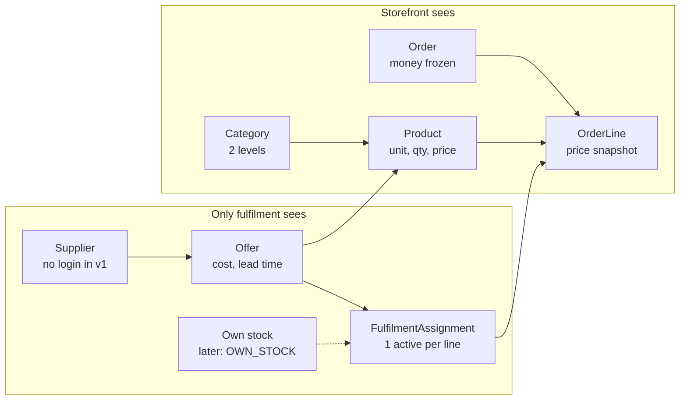

# Platform Design v1 — MVP Spec

**Status:** Draft for review (S1 Design) · 2026-10-21 · Arvind

## 1. Scope

The MVP is a single-seller storefront for Gurgaon: customers order construction materials in small quantities, the owner prices every item, and each order line is assigned by hand to a local supplier. The data model already separates *what is sold* from *who supplies it*, so multiple suppliers and own inventory arrive later as new record types, not a rebuild.

**Operating-model status.** This is the canonical design doc `docs/Platform_Design_v1.md`, drafted in an S1 Design session. It is a draft until independently validated and accepted. `DOCTRINE.md` should be written first; §2 lists the doctrine seeds this design depends on.

**In scope (MVP)**

- Customer storefront: browse by category, product page, quantity selection, cart
- Checkout: phone OTP login, delivery address, delivery slot, UPI or cash on delivery
- Product catalogue owned by the owner (30–50 SKUs at launch)
- Order management and manual supplier assignment in an admin panel
- Supplier records with cost price per product (no supplier login)
- Order notifications to customer by SMS or WhatsApp

**Out of scope (MVP)**

- Supplier login, supplier-managed listings, supplier payouts
- Own inventory, warehouses, stock counts
- Automatic supplier routing or cheapest-offer selection
- Credit accounts, contractor tiers, bulk quotes, coupons
- Native mobile apps (the storefront is a mobile-first web app)
- Delivery outside configured Gurgaon pincodes

## 2. Doctrine seeds

This design is only correct if these five invariants hold. They are proposals to lift into `DOCTRINE.md` §2, not doctrine until you accept them.

|  | Proposed invariant | Why it is load-bearing |
| --- | --- | --- |
| **I-1** | The customer always buys a platform Product; a supplier never appears on the storefront. | Brand and price control stay with you; suppliers can change without customer impact. |
| **I-2** | Selling price and supplier cost are separate fields with separate owners; neither is derived from the other at runtime. | Margin is explicit and auditable; a later marketplace commission model fits without rework. |
| **I-3** | An order's prices, quantities and charges are frozen at placement; catalogue edits never rewrite a placed order. | Prices for cement and steel move weekly; disputes need the price the customer agreed to. |
| **I-4** | Every order line has exactly one fulfilment source at a time, and every change of source or status is logged with who and when. | Manual assignment is the MVP's core operation; without a log, failed deliveries cannot be traced. |
| **I-5** | Money is stored as integer paise; quantities in a declared unit per product. | Avoids rounding errors in GST and delivery fee maths. |

**Candidate refusals:** no supplier-facing surfaces in v1; no automated price changes; no orders accepted outside serviced pincodes.

## 3. Architecture

One deployable app (a modular monolith) on one Postgres database. Storefront and admin are two route groups of the same app. Microservices, queues and a separate admin app are deliberately not used until volume proves the need.

| Layer | Recommendation | Reason |
| --- | --- | --- |
| App | Next.js (App Router) + TypeScript | One codebase for storefront, admin and API; server rendering for SEO and fast mobile pages |
| Database | Postgres (managed, Mumbai region) | Relational data, transactions for order placement |
| ORM / migrations | Prisma or Drizzle | Typed schema; migrations under version control |
| Payments | Razorpay (UPI, cards) + COD | Standard Indian gateway; webhook confirms payment |
| OTP and messages | An Indian SMS/WhatsApp provider (e.g. MSG91, Gupshup) | Phone-first login and order updates |
| Images | Object storage + CDN | Product photos |
| Hosting | Managed platform with an India region | No servers to run in v1 |

**Module boundaries** (folders in one repo, each owns its tables):

- `catalog` — categories, products, units, images
- `pricing` — selling price, delivery fee rules, serviceable pincodes
- `checkout` — cart, address, slot, order placement
- `orders` — order and line state, status history
- `fulfilment` — suppliers, offers, assignment of lines to a source
- `payments` — gateway integration, payment records, COD collection
- `identity` — customers, admin users, OTP
- `notify` — SMS/WhatsApp templates and sends

**Boundary rule:** only `fulfilment` knows suppliers exist. `catalog`, `checkout` and the storefront never import from it. This is what keeps I-1 true and makes the later supplier portal a change to one module.

## 4. Domain model

The core decision: a **Product** is what the customer buys, an **Offer** is one supplier's ability to supply it, and a **FulfilmentAssignment** links one order line to one source. Own inventory later becomes a second kind of source, not a second kind of product.



Arrows run from catalogue and supply toward the order line. An Assignment ties an OrderLine to a supplier's Offer today, and to own stock later; nothing on the storefront side changes.

| Entity | Key fields | Owner module | Notes |
| --- | --- | --- | --- |
| Category | name, slug, parent, sort | catalog | Two levels max (e.g. Cement › OPC 53) |
| Product | name, brand, spec, sell\_unit, min\_qty, step\_qty, max\_qty, weight\_kg\_per\_unit, hsn\_code, gst\_rate, status, images | catalog | Platform-branded SKU; never references a supplier |
| ProductPrice | product, selling\_price\_paise, effective\_from, set\_by | pricing | Append-only; current price = latest row |
| ServiceArea | pincode, zone, active | pricing | Gates checkout (candidate refusal) |
| DeliveryFeeRule | zone, weight band, vehicle type, fee\_paise, min\_order\_paise | pricing | See §6 |
| Supplier | name, contact, phone, gstin, address, zones served, status | fulfilment | No login in v1 |
| Offer | supplier, product, cost\_price\_paise, lead\_time\_hours, available, last\_confirmed\_at | fulfilment | Many per product; used to pick a supplier at assignment |
| Customer / Address | phone, name; address lines, landmark, pincode, location pin | identity | Phone is the identity |
| Order | number, customer, address snapshot, slot, subtotal, delivery\_fee, gst, total, payment\_method, payment\_status, status, placed\_at | orders | All money frozen at placement (I-3) |
| OrderLine | order, product, product snapshot (name, unit, gst\_rate), unit\_price\_paise, qty, line\_total, status | orders | Snapshot, not a live join to Product |
| FulfilmentAssignment | order\_line, source\_type, supplier, offer, cost\_price\_paise, assigned\_by, assigned\_at, active | fulfilment | One active row per line (I-4); reassignment deactivates, never deletes |
| OrderEvent | order, line?, event\_type, from, to, actor, at, note | orders | Append-only audit log |
| Payment | order, method, gateway\_ref, amount\_paise, status | payments | COD recorded on collection |

`source_type` is an enum with one value in v1: `SUPPLIER_SOURCED`. Later values are added in §10 without changing Order or OrderLine.

## 5. Catalogue and quantity rules

Every product declares one selling unit and its own quantity limits; the cart enforces them, and the server re-checks them at placement.

- **Selling unit** — one per product, from a fixed list: `bag`, `piece`, `kg`, `ton`, `cft`, `metre`, `sqft`, `litre`, `box`. No unit conversion in v1 (a 50 kg cement bag is sold in bags, not kg).
- **Quantity rule** — `min_qty`, `step_qty`, `max_qty` per product. Example: bricks min 500, step 100; cement min 1, step 1, max 200.
- **Weight** — `weight_kg_per_unit` is mandatory; it drives delivery fee and vehicle type.
- **Product page** shows unit, price per unit, GST-inclusive price, minimum order, expected delivery window and spec (grade, size, brand).
- **Availability** — a product is orderable when it is active and has at least one available Offer. The storefront sees only a yes/no flag, never the offers (I-1).
- **Launch catalogue** — 30–50 SKUs across cement, bricks/blocks, steel (TMT), plumbing, electrical and hardware. Sand and aggregate are *shown with a WhatsApp enquiry button, not orderable online,* until supply and pricing are stable.
- **Search** — category browsing plus simple text search on name, brand and spec; no search engine in v1.

## 6. Pricing and delivery charges

You set every selling price by hand; the system only adds delivery and GST. Supplier cost is visible to admins only and is used to show margin, never to compute price (I-2).

**Order total**

```latex
\text{total} = \sum_{\text{lines}} (\text{unit price} \times \text{qty}) + \text{delivery fee}
```

- **Prices are GST-inclusive** on the storefront. The invoice breaks out taxable value and GST per line from `gst_rate` and `hsn_code`.
- **Delivery fee** comes from `DeliveryFeeRule`: zone (from pincode) × total order weight band → vehicle type and fee. Example bands: up to 100 kg two-wheeler or e-cart; 100–1,000 kg small tempo; 1–3 t pickup; above 3 t manual quote.
- **Minimum order value** per zone. Below it, checkout is blocked with the shortfall shown.
- **Free-delivery threshold** per zone is optional and off by default.
- **Price change** = a new `ProductPrice` row from the admin panel. Carts re-price on every view; placed orders never change (I-3).
- **Margin view** in admin: selling price − active offer cost, per line and per order, after assignment.

The fee bands and minimums above are placeholders. They need your numbers from real tempo rates in Gurgaon before launch (§11).

## 7. Storefront and checkout

A mobile-first web app where a customer can go from landing to placed order in under 2 minutes, logging in only at checkout.

**Pages:** Home (categories, popular items) · Category list · Product detail · Cart · Checkout · Order confirmation · My orders · Order detail and status · Static pages (about, delivery areas, terms, refunds, contact).

**Checkout flow**

1. Customer enters a pincode on first visit (or at cart). Non-serviced pincodes see a clear message and a WhatsApp contact; they can browse but not check out.
2. Adds products with a quantity stepper that follows `min/step/max`. The cart shows weight, delivery fee and minimum-order shortfall live.
3. Taps checkout and logs in with phone OTP.
4. Picks or adds an address with landmark and a map pin (site addresses are often unnumbered).
5. Picks a delivery slot: date + morning or afternoon. Earliest date = today + the configured lead time (default next day).
6. Optionally adds a GSTIN and business name for a B2B invoice.
7. Chooses UPI/card (Razorpay) or cash on delivery. COD can be capped by order value.
8. Server re-validates pincode, quantities, prices and availability, then places the order in one transaction and freezes its money (I-3).
9. Confirmation page plus SMS/WhatsApp with the order number.

**Order statuses the customer sees:** Placed → Confirmed → Out for delivery → Delivered, or Cancelled. Internal states (§8) map onto these five.

**Cancellation:** the customer can cancel until the order is Confirmed; after that, by contacting support.

## 8. Order lifecycle and manual supplier assignment

State lives on the order line, because one order can be fulfilled by several suppliers; the order's status is derived from its lines. Every transition writes an `OrderEvent` (I-4).

**Line states:** Unassigned → Assigned → Supplier confirmed → Dispatched → Delivered. A failed or refused line returns to Unassigned for reassignment. Any line can be Cancelled before dispatch.

**Order status (derived):**

| Order status | Rule | Customer sees |
| --- | --- | --- |
| Pending payment | Prepaid order, gateway not yet confirmed | Not shown; expires in 30 min |
| Placed | Paid or COD, any line not yet supplier-confirmed | Placed |
| Confirmed | Every active line supplier-confirmed | Confirmed |
| Out for delivery | At least one line dispatched | Out for delivery |
| Delivered | Every active line delivered | Delivered |
| Closed | Delivered and payment settled (COD collected) | Delivered |
| Cancelled | All lines cancelled | Cancelled |

**Manual assignment procedure (admin)**

1. A new order appears in the *To assign* queue with an age timer.
2. For each line, admin sees the product's offers: supplier, cost, margin, lead time, last confirmed date. Offers that do not serve the delivery zone are hidden.
3. Admin picks one offer per line, or *Assign all to supplier X*. This creates the active `FulfilmentAssignment` and snapshots cost.
4. System generates a supplier order message (items, quantities, delivery address, map pin, slot, contact) to copy into WhatsApp. No automated supplier messaging in v1.
5. Admin marks *Supplier confirmed* after the call or message back. If refused, *Reassign* deactivates the old assignment and returns to step 2.
6. Admin marks *Dispatched* (optional driver name and phone) and *Delivered* (optional photo of proof of delivery).
7. For short or damaged delivery, admin records delivered quantity; the difference becomes a refund amount on the order.

**Payments:** prepaid orders confirm by gateway webhook, never by the browser redirect alone. COD is marked collected by admin at delivery. Refunds are processed in Razorpay and recorded by admin in v1.

## 9. Admin panel

A desktop-first `/admin` area for you and up to 2–3 operators, built for running 20–50 orders a day by hand.

| Screen | What it does |
| --- | --- |
| Dashboard | Today's orders by status, *To assign* queue, orders past slot, revenue and gross margin today/week |
| Orders | List with filters (status, date, zone, supplier); order detail with lines, assignments, event log, payment, notes |
| Assignment | Per-line offer picker, bulk assign, supplier message generator, confirm / reassign / dispatch / deliver actions (§8) |
| Products | Create and edit products, units, quantity rules, weight, GST, images; activate or deactivate |
| Pricing | Edit selling prices (single and bulk CSV), view price history, delivery fee rules, minimum order, service pincodes |
| Suppliers | Supplier records, zones served, and their offers (cost, lead time, available); bulk cost update by CSV |
| Customers | Customer list, their orders and addresses |
| Settings | Lead time, slots, COD cap, notification templates, admin users |

**Roles:** two in v1 — *Owner* (everything, including costs and margins) and *Operator* (orders and assignment, no cost or price editing). Admin login is email + password with 2FA, separate from customer OTP.

**Exports:** orders and lines as CSV for accounting; GST invoice PDF per order.

## 10. Extension path

Each future capability is an addition to `fulfilment` or `pricing`; Order, OrderLine and the storefront stay unchanged. These are deferred-design seeds, not commitments.

| Stage | Adds | Data model change | Trigger to start |
| --- | --- | --- | --- |
| Assisted routing | System suggests the best offer per line (cost, lead time, zone) | None; reads existing Offers | Assignment takes more than \~5 min per order |
| Supplier portal | Supplier login to see assigned lines, confirm, update cost and availability | `SupplierUser`; Offer edits by supplier, still approved by you | More than \~5 active suppliers |
| Supplier-managed listings | Suppliers propose products and offers; you approve and set selling price | `Offer.status` (proposed / approved); product proposal flow | Catalogue growth outpaces your manual entry |
| Marketplace mode | Supplier is seller of record; you earn commission | `Offer.selling_model` (resell / marketplace); payouts and settlements | Tax and legal decision taken (§11) |
| Own inventory | You hold stock of fast movers | `StockLocation`, `StockLevel`, `StockMovement`; `source_type = OWN_STOCK` | A few SKUs move enough volume to justify holding stock |
| New city | Second service area | New zones, fee rules, suppliers; no code change | Gurgaon unit economics proven |

Rule for every stage: reserving own stock or routing to a supplier happens through a `FulfilmentAssignment`, so reporting and audit work the same for every source.

## 11. Open decisions

These need your explicit call before implementation reaches them; per the operating model, code stops at an unanswered design question rather than deciding inline.

| # | Decision | Options | Blocks |
| --- | --- | --- | --- |
| D1 | Seller of record in v1 | (a) You resell: your GSTIN on every invoice · (b) Supplier invoices the customer | Invoice, tax and payment design; legal entity setup |
| D2 | Brand name and domain | — | Storefront, SMS sender ID, payment gateway onboarding |
| D3 | Delivery: who drives | (a) Supplier delivers · (b) Your hired tempo · (c) Mix | Dispatch screen, delivery fee rules |
| D4 | Delivery fee bands and minimum order per zone | Needs real Gurgaon tempo rates | Pricing config, checkout |
| D5 | COD allowed, and cap | Off · on with cap · on uncapped | Checkout, cash handling |
| D6 | Launch pincodes | Start with 4–6 sectors or all of Gurgaon | Service area config, supplier coverage |
| D7 | Stack confirmation | §3 recommendation or your preference | All implementation sessions |
| D8 | Launch SKU list (30–50) | — | Catalogue seed data |

## 12. Build sequence

About ten sessions take the MVP from empty repo to launch, each one PR with one scope. Risk tier follows the operating model's rule: money, persistence and auth paths are High regardless of size.

| Session | Intent | Scope | Risk tier |
| --- | --- | --- | --- |
| S1 | Design | This spec + `DOCTRINE.md` + `CONSTRAINTS_CARD.md`; independent validation; ADR-001 (operating model), ADR-002 (Product/Offer/Assignment model) | — |
| S2 | Implementation | Repo scaffold, operating-model templates, stack setup, full schema and migrations, seed data | High (persistence) |
| S3 | Implementation | Catalogue browsing: home, category, product pages, search | Low |
| S4 | Implementation | Cart, quantity rules, pincode gate, delivery fee and minimum order | Medium |
| S5 | Implementation | Customer OTP login, addresses, slots, order placement transaction | High (auth, money) |
| S6 | Implementation | Razorpay integration, webhook, COD, payment records | High (money) |
| S7 | Implementation | Admin auth and roles, order list and detail, assignment workflow, event log | High (auth, persistence) |
| S8 | Implementation | Admin products, pricing, suppliers, offers, CSV imports | Medium |
| S9 | Implementation | SMS/WhatsApp notifications, GST invoice PDF, exports | Medium |
| S10 | Investigation | Launch readiness: end-to-end test orders with real suppliers, fixes | Medium |

Suggested `ACTIVE_ARCHITECTURE.md` rows once built: one per module in §3, each pointing to this document until a module earns its own design doc.
